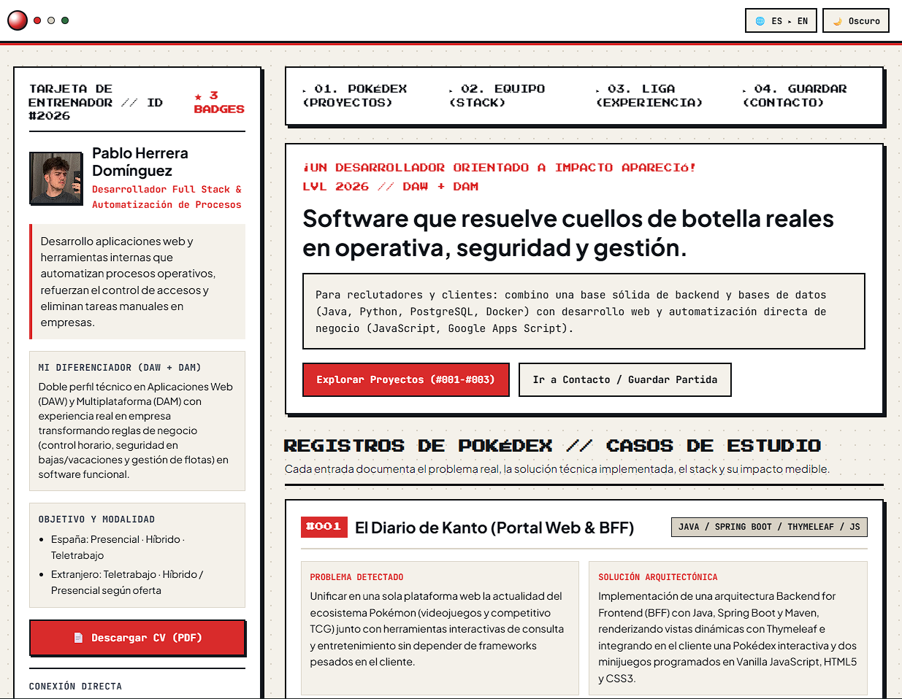

# Portfolio Personal — Pablo Herrera Domínguez (Pokédex Field OS)

Portfolio profesional desarrollado con **Angular 21**, **TypeScript estricto**, **Componentes Standalone** y **Signals**, diseñado bajo el concepto visual **Pokédex Field OS**: una interfaz editorial técnica inspirada en manuales de campo japoneses y consolas clásicas, con un **Modo Rápido de Reclutador** para lectura ejecutiva en menos de 10 segundos.

## Captura de pantalla

## Stack Tecnológico del Proyecto

- **Framework**: Angular `^21.2.0` (Standalone Components + Signals)
- **Lenguaje**: TypeScript `~5.9.2`[cite: 10]
- **Estilos**: SCSS nativo con paleta de 5 colores en CSS Custom Properties (sin librerías de UI pesadas)
- **Audio**: Síntesis 8-bit generada en tiempo real con **Web Audio API** (opt-in, sin archivos externos)
- **Calidad y Testing**: Prettier `^3.8.1` y Vitest `^4.0.8`[cite: 10]

## Decisiones de Diseño y Arquitectura

1. **Identidad propia sin sacrificar conversión**: La columna izquierda actúa como *Tarjeta de Entrenador* fija (nombre, propuesta de valor, diferenciador DAW+DAM, disponibilidad y contacto directo) y la derecha como visor de casos de estudio (`#001`–`#005`), Equipo Titular de 6 tecnologías (`Java`, `JavaScript`, `Google Apps Script`, `Docker`, `PostgreSQL`, `Python`) y Camino a la Liga (`Texla Renovables`, `DAM`, `DAW`).
2. **HTML inicial con contenido real**: `index.html` incluye contenido semántico real dentro de `<app-root>` junto con metadatos Open Graph, Twitter Card y `JSON-LD` (`Person`) para indexación inmediata.
3. **Mantenibilidad en un único archivo**: Todos los textos bilingües (`ES`/`EN`), proyectos y enlaces de contacto residen en `src/app/data/portfolio.data.ts`.
4. **Accesibilidad WCAG AA**: Navegación completa por teclado (`skip-link`, `:focus-visible`), soporte nativo para `prefers-reduced-motion: reduce` y botón de **Modo Rápido**.
